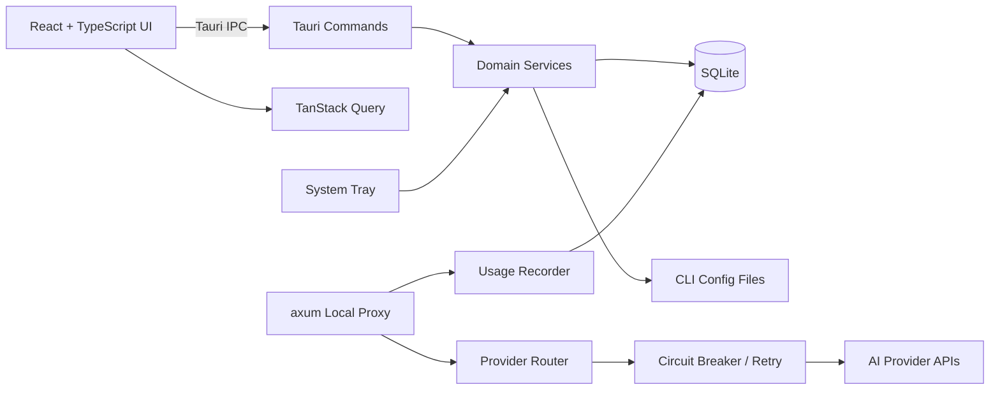

# XY Switch 整体设计文档

## 1. 项目范围

本阶段仅交付 Windows 版本，不包含 macOS、Linux、用户认证与登录。项目采用 MIT 协议。

## 2. 总体架构

## 3. 模块划分

- `src/features/providers`: 供应商列表、编辑、切换、排序与复制。
- `src/features/mcp`: MCP 配置、模板、导入与原子写入。
- `src/features/prompts`: Markdown 提示词及目标文件同步。
- `src/features/skills`: 仓库浏览、安装、卸载和发现。
- `src/features/sessions`: 会话检索、恢复和删除。
- `src/features/usage`: Token、成本、延迟与趋势。
- `src-tauri/src/commands`: Tauri IPC 边界，仅负责校验和调用服务。
- `src-tauri/src/repositories`: SQLite 数据访问。
- `src-tauri/src/proxy.rs`: 本地 HTTP 代理入口。

## 4. 数据流

1. React 通过 TanStack Query 调用 Tauri IPC。
2. Command 层校验输入并调用 Repository。
3. Repository 使用事务访问 SQLite。
4. 供应商切换写入数据库后，由接管模块原子更新对应 CLI 配置。
5. axum 代理读取当前路由，根据健康状态执行重试和故障转移。
6. 请求结束后异步写入用量、成本、延迟和结果状态。

## 5. 安全设计

- API Key 不写入日志，不通过普通错误信息回显。
- Windows 正式版本使用 DPAPI 或系统凭据库加密密钥。
- 导出配置默认排除密钥，包含密钥时必须显式选择并提示风险。
- CLI 配置采用临时文件、刷新、原子替换，避免半写入文件。
- 本地代理默认仅监听 `127.0.0.1`。

## 6. UI 优化

不改变原有操作路径，只优化表现：

- 使用清晰的页面标题、统计摘要、筛选区和内容区层级。
- 当前供应商、健康状态和延迟使用一致的状态色与文本双重表达。
- 卡片切换保留单击路径，并增加明确焦点态和键盘操作。
- 编辑使用侧边面板，避免用户离开当前列表上下文。
- 危险操作使用二次确认，批量或拖拽操作提供撤销入口。
- 明暗主题使用设计变量，保证文字与背景对比度。
- 窄窗口自动切换为单列，侧栏折叠但不改变导航顺序。
- 动画控制在 120 到 200 毫秒，并遵循减少动态效果设置。

## 7. Windows 构建

- 开发：`pnpm tauri dev`
- 前端验证：`pnpm build`
- Rust 验证：`cargo check --manifest-path src-tauri/Cargo.toml`
- Windows 安装包：`pnpm tauri build --bundles msi`
- 便携 ZIP：由 `scripts/package-portable.ps1` 打包编译后的 exe 和说明文件。

## 8. 后续扩展

macOS 签名、公证、DMG 和 Linux deb/AppImage 将作为独立里程碑新增，不进入当前 Windows 验收范围。

