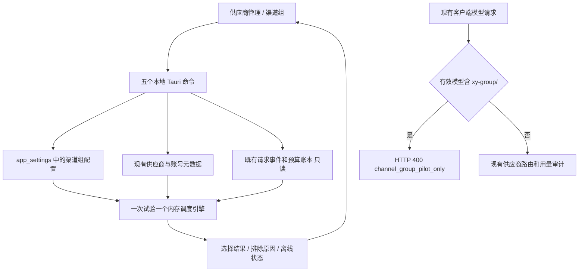

# XY Switch 渠道组：第一阶段架构

版本：1.3.0 预发布。更新：2026-11-15。

## 交付状态

第一阶段已实现配置持久化、离线调度引擎、既有账本只读视图、历史事件回放，以及供应商管理中的“渠道组”入口。可创建、编辑、启用或停用离线组，查看策略与渠道状态。真实多渠道转发尚未启用，客户端配置不会自动改写。

`phase=offlinePilot`、`liveEnabled=false`、`billingHold=true`、`dispatchAllowed=false` 是程序固定返回值，不存在通过组配置打开真实转发的开关。模拟结果固定 `liveDispatches=0`、`ledgerWrites=0`。

一笔既有 HTTP 525 请求的实际 Token 与费用仍未核实，收费验收继续暂停。本次渠道组实现与原生验收新增真实模型请求为 **0**；合成接收器仅绑定本机回环地址。

接口和公开验收摘要分别见[接口契约](channel-groups-contract.md)、[1.3.0 验收报告](channel-groups-acceptance-1.3.0.md)。原始收费记录和本地数据库保留在本地验收归档。

## 组件与数据流

| 部件 | 责任与复用方式 |
|---|---|
| 渠道组配置 | 存在既有 `app_settings` 的 `channel_groups.pilot.v1` 键；不新增数据库表 |
| 渠道引用 | 保存 `providerId`、可选 `accountId`、`upstreamModel`；不保存端点或凭据副本 |
| 元数据 | 读取既有供应商启用状态、账号归属、模型权限、限流与额度快照；不取密钥、不刷新账号 |
| 配置保存 | 组与共享项目预算在同一事务中更新；分别校验 revision；冲突回滚 |
| 调度引擎 | 所有组共同装入一个试验实例，原子执行“过滤、选择、预留”，支持跨组共享约束 |
| 既有用量 | 只读 `request_events`、`proxy_attempts`、`budget_ledger`；模拟不落真实账本 |
| 展示层 | 使用现有表单、对话框、导航保护与中英文体系；主页面简洁，高级参数折叠 |

实现入口：[本地命令](<../src-tauri/src/commands/channel_groups.rs>)、[存储层](<../src-tauri/src/channel_groups/store.rs>)、[调度引擎](<../src-tauri/src/channel_groups/engine.rs>)、[渠道组页面](<../src/features/providers/ChannelGroupsPage.tsx>)。

## 选择顺序与策略

1. 校验请求 ID、组 ID、预留量、时间和状态标识；同一个逻辑请求 ID 在同一试验内只被考虑一次。
2. 检查组、渠道、供应商、账号和模型权限。供应商有账号池时，要求渠道明确选择账号，避免渠道内再发生隐式账号切换。
3. 计算会话亲和性。已有状态只能使用原渠道；身份未知、过期、冲突或原渠道不可用均返回明确原因。
4. 过滤鉴权隔离、冷却、RPM、TPM、并发、真实额度和预算限制。
5. 无亲和性时选取可用渠道中最小的 priority；相同优先级内执行策略。
6. 一次只返回一个渠道，同时预留该渠道和所属共享池的请求、Token、并发及金额。没有自动跨渠道重试循环。

| 策略 | 当前离线算法 | 相同分数或证据不足 |
|---|---|---|
| `roundRobin` | 按配置渠道顺序轮转，跳过不可用项 | 游标持续前移 |
| `weightedRoundRobin` | 同优先级候选执行平滑加权轮询 | 按轮询游标顺序打破平局 |
| `leastLoad` | 比较当前并发 / 渠道并发上限；未设上限时分母为 1 | 按轮询游标顺序打破平局 |
| `latencyFirst` | 使用已观测延迟；模拟完成按旧值 80%、新值 20% 更新 | 未观测为未知，全部未知时轮转 |
| `quotaAware` | 比较已知剩余请求数、剩余 Token / 本次 Token 预留量的最小值 | 有证据优先；全部未知时轮转 |

配额感知的分数只反映已有的维度。例如只有剩余请求数时，可以据此排序，但剩余 Token 仍显示未知。五种策略都先服从健康、共享限额、预算和亲和性约束。

## 共享账号与配额池

- 相同 provider、相同归一化 URL origin、相同显式 `quotaPoolId`，或双方都未声明额度关系的渠道，保守合入一个池；合并关系具有传递性，也覆盖不同组。
- 同 origin 即使声明独立也保守合池并发出说明。配置只表达用户声明，不证明真实上游账户或配额独立。
- `poolDeclared` 表示该池成员都填写过关系声明，不能解释为“独立性验证通过”。不同 origin 下的独立声明须在后续真实接入前核实。
- 池内 RPM、TPM、并发上限取已配置限制中的最小值，使用量合并计算，容量不按渠道数量相加。
- 429 冷却传播到共享池；401/403 隔离相同 provider/account 引用。历史事件没有精确账号归属时，保守影响该供应商的所有引用渠道。
- 对重复引用的供应商历史事件，一个共享池只计一次窗口使用量。单渠道的回放窗口计数不等于历史的真实渠道归因。

额度来自账号元数据中的已记录快照或试验输入中的响应证据。只使用 Requests / Tokens 单位的有效余额，不把百分比换算成 Token。

## 限流窗口与恢复

### 响应证据

当前解析 `Retry-After`、`x-ratelimit-remaining-requests`、`x-ratelimit-remaining-tokens`、`x-ratelimit-reset-requests`、`x-ratelimit-reset-tokens`。头名大小写不敏感；重复规范化头名和过大输入被拒绝。非法单个值不产生余额。

`Retry-After` 支持整数秒与 HTTP 日期。两个 reset 头使用带单位的相对时间，可组合 `ms/s/m/h/d`，例如 `1m30s`。其他供应商的专用头、绝对时间戳和配额接口需在后续适配，第一阶段不会自行猜测含义。

429 使用响应和已有额度窗口中最长的有效恢复时间；显式上游等待时间不受本地最大退避时间截短。没有有效时间证据时，使用渠道配置的指数退避及上限。较早请求的成功返回不能清除仍有效的冷却。

### 多窗口与未知

- 每个请求/Token 窗口独立保存、扣减和过期；短窗口过期不释放仍有效的长窗口。
- 返回的余额是所有有效窗口中的最小值。为防过分乐观，下一恢复时间覆盖仍受限窗口；缺少恢复时间时返回 null。
- 余额观测扣除同池其他未确认请求的预留；已知实际 Token 超出预留后，额外消耗也扣除，并继续计入未知结果的保留量。
- 到达 reset 只使对应余额观测失效，不自动补满。过期后的余额为 null，等待新证据。
- 无 reset 的正余额最多保留 60 秒；无 reset 的零余额保守保持为零，不能猜测恢复。
- `quota.source` 是该池最近写入的观测来源；一个池可同时保留其他来源的更长窗口，不能据此声称全部窗口都来自这个来源。

解析实现：[headers.rs](<../src-tauri/src/channel_groups/headers.rs>)。协议依据：[RFC 9110，Retry-After](https://www.rfc-editor.org/rfc/rfc9110.html#section-10.2.3)。OpenAI 风格头名及状态字段的对接参考见接口契约；当前结论以已实现的解析和离线测试为准。

## 请求结果、会话和重复计费防护

| 事件 | 预留与后续行为 |
|---|---|
| 选中渠道 | 建立唯一 attempt，立即增加并发和窗口使用量 |
| `streamStarted` | 标记已经输出；该请求不能再被声明为未发送 |
| 明确 HTTP 2xx/3xx/4xx 完成 | 释放并发；保留费用承诺，按有证据的实际值更新用量；不自动重发 |
| 401/403 | 隔离同 provider/account 的渠道，不进入普通 429 退避 |
| 429 | 保留请求消耗，按上游证据冷却共享池，不自动重发 |
| 超时、取消、未知传输、HTTP 5xx（含 525） | 保留并发和金额预留；标记未知结果并冷却，不跨渠道重发 |
| `notSent` | 只有尚未输出且没有用量/头部证据时才接受；释放预留与临时亲和性 |

实际 Token 和费用只记入 `knownTokens` / `knownMicrousd` 的已知小计，同时保留已知条数。预算预留不是实际费用；未知结果不会因试验结束被补成零费用。

会话标识按组隔离，以带种类前缀的 SHA-256 键保存内存亲和性；支持 `sessionKey`、`previousResponseId`、`conversationId`。成功结果中的响应 ID / 会话 ID 绑定原渠道。亲和性优先于 priority 和策略；过期绑定明确拒绝，不静默迁移。第一阶段不持久化服务端会话绑定，也不读取真实客户端会话。

## 预算与现有账本

- 金额使用整数 μUSD，1 USD = 1,000,000 μUSD；日预算按 UTC 日切换。已有浮点美元费用保守转换到 μUSD，不把非法或缺失金额解释为零。
- 请求事件用于“已记录真实用量”的展示。attempt 与账本关联用于预算承诺：同一个 attempt 的实际费用、预留、关联事件与账本值取最大值，避免重复相加。
- 缺少关联 ID 的旧事件和旧账本无法证明是同一笔；预算使用保守上界，可能高估承诺。这个上界不是新账单，实际费用小计仍来自已知事件。
- 渠道预算独立配置；本次试验的渠道承诺独立累计。旧数据只有 provider 归属时，整个供应商当日承诺保守参与渠道检查，不能精确还原过去的单渠道支出。
- 项目预算跨组共享；参与供应商去重后读取旧承诺，再叠加该项目本次试验的承诺。
- 配置预算但没有本次金额预留时，返回 `cost_reservation_required`；当日旧账本有未定价记录时返回 `unresolved_ledger_cost`。
- 页面将历史用量按供应商去重展示；`recordedUsage` 在多个渠道视图中可能引用同一份数据，禁止相加作为组总量。

实现：[ledger.rs](<../src-tauri/src/channel_groups/ledger.rs>)。配置保存仅写设置项，模拟、回放和状态读取均不写计费账本。

## 历史回放和状态解释

状态快照最多恢复最近 2048 个相关供应商事件；达到上限时返回说明。事件列表最多读取 200 条。回放按事件时间和 ID 排序，重复 ID 或跨目标组供应商的事件被拒绝。

旧事件未保存完整限流头，回放 429 时只能使用配置冷却，并返回 `recorded_headers_unavailable_configured_cooldown_used`。缺失 Token 的窗口在 `tpmUnknownRequests` 中体现，配置 TPM 时保守拒绝不确定窗口。

历史 401/403 没有凭据代次信息，不能判断用户此后是否更换过凭据，因此展示为回放中的鉴权隔离，不声称当前真实鉴权仍失败。错误率覆盖本次内存实例中的观测；RPM/TPM 使用最近 60 秒窗口。`ready`、`degraded` 等均为本地回放或模拟状态，不证明实时可用性。

每次模拟都会从已保存配置、现有元数据、账本以及明确选中的历史事件重新建立引擎。相同快照和输入给出确定性结果；外部账本/元数据变化可能改变下次结果。页面固定试验生成 6 条合成请求，不生成模型内容，也不主动制造“成功完成”事件。

## 真实入口保护

网关保留 `xy-group/` 命名空间。直接 JSON 模型、Gemini URL 模型、默认模型、别名映射、请求体覆盖、备用候选及诊断入口都会校验。匹配时返回 HTTP 400 / `channel_group_pilot_only`。

门禁在凭据读取、账号刷新、任务登记、预算预留、请求事件和上游发送之前生效。组不存在、停用或已启用离线状态都不能绕过门禁。普通模型继续走既有协议路由和现有审计。依据：[网关门禁测试](<../src-tauri/src/channel_group_proxy_tests.rs>)。

## 后续真实接入的完成条件

第一阶段并未完成真实接入验收。进入下一阶段前，需要先核实 superapi 525 那一笔的实际用量和费用，满足原收费测试的停止/恢复条件。

后续实施还需将单次选择接入现有唯一派发与审计路径、绑定持久化状态及凭据代次、按供应商完善额度证据适配、核实共享账号/额度关系与服务条款，并在原授权范围和额度内验收流式完成、未知结果对账和客户端接入。不得仅修改 `liveEnabled` 返回值或删除命名空间门禁就视为完成这些条件。
