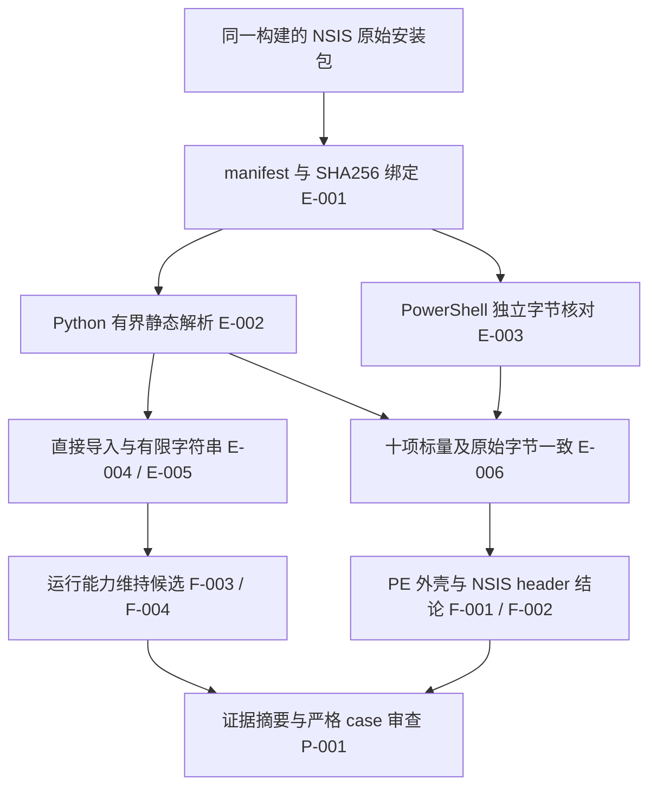

# XY Switch Windows 安装器离线逆向报告

分析日期：2026-11-02；PRIMARY：reverse-engineering / R0；报告 flavor：null。

## 1. 概述与授权范围

本次分析用于验证 reverse-skill 插件能对自有安装包完成真实静态业务、独立核对和可复现交付。唯一目标为源码提交 `fe4946bd2fcd4c27a7432aeadb5a656e0e6e676b` 的 NSIS 安装器外壳，来源为构建运行 41419299553。范围契约为 case 的 `scope.md`：own_system、granted、offline、ready_for_act=true；覆盖 installer_container / offline_static_pe_analysis。

已确认文件与构建清单一致，PE 外壳为 I386 / PE32，NSIS firstheader 与 overlay 边界在两种独立实现中相符。已解析直接导入和有限字符串；这些观察的范围是外壳，不覆盖压缩 payload 的完整行为。工具只读取样本，`sampleExecuted=false`；收费 API 调用为 0。动态安装及原生功能的证据见同日安装包与插件验收报告，其执行环境为 disposable GitHub-hosted CI。

## 2. 样本与工具

| 属性 | 观察 |
| --- | --- |
| 文件 | XY-Switch-1.2.0-windows-x64-setup.exe |
| 字节数 | 5,275,657 |
| SHA256 | `6371977825a2d914b7d3d5124ba6d2fff6924e7db1406af39be27b23eac92869` |
| MD5（识别信息） | `71bad152aec3ac3fae8bb8f28a0a9af9` |
| PE 头偏移 | 216 / 0xd8 |
| Machine / optional header | 0x014c / I386；0x010b / PE32 |
| 节表 | .text、.rdata、.data、.ndata、.rsrc |
| 入口 | RVA 13983；文件偏移 10911 |
| Python | tool-index 注册的 C:/Python314/python.exe；标准库 hashlib、struct、re |
| 独立实现 | PowerShell Get-FileHash / .NET BitConverter |

入口地址仅表示 PE 静态字段，本次未反汇编或执行入口。COFF 时间戳保留为原始字段，未据此认定应用编译时间。

## 3. Evidence 记录

每份 `evidence/E-*.md` 保存 source_ref、可复现读取命令、SHA256、case 内 artifact_path 和工作项关联。以下结果均为原始观察文件；参考文档与观察分开固定摘要。

| ID | 原始产物 | 用途 |
| --- | --- | --- |
| E-001 | evidence/manifest-binding.json | 构建清单、样本摘要前后与来源提交 |
| E-002 | evidence/pe-analysis.json | Python 有界 PE、节表、目录与 overlay 解析 |
| E-003 | evidence/independent-header.json | PowerShell 独立读字节及摘要 |
| E-004 | evidence/imports.json | 7 模块、163 项直接导入，RVA / IAT / 文件偏移 |
| E-005 | evidence/selected-strings.json | 5 项有限静态字符串及偏移 |
| E-006 | evidence/header-comparison.json | 10 项标量和原始字节全部一致 |
| E-007 | evidence/reference-observation.json | Microsoft / NSIS 官方参考快照的来源与摘要 |

E-002 与 E-003 为独立实现；E-004 和 E-005 是 E-002 同一解析器的拆分结果，不作为独立行为证据。

## 4. 静态分析

### 4.1 导入表

| 模块 | 直接导入数 |
| --- | ---: |
| ADVAPI32.dll | 12 |
| SHELL32.dll | 5 |
| ole32.dll | 5 |
| COMCTL32.dll | 4 |
| USER32.dll | 64 |
| GDI32.dll | 8 |
| KERNEL32.dll | 65 |
| 合计 | 163 |

导入描述符与 thunk 使用有界读取并要求终止记录。`LoadLibraryExW` 和 `GetProcAddress` 是动态加载锚点；完整 RVA、IAT RVA 与名称文件偏移留在 E-004。有限字符串包含 NSIS 标识及上述 API 名称，未把截断字符串当成完整资源内容。

### 4.2 NSIS 容器边界

overlay 从 54272 / 0xd400 起，长度为 5221385 字节。其起点有 28 字节 firstheader，signature word 为 0xdeadbeef，随后三字对应 NullsoftInst。`length_of_header=77948`，`length_of_all_following_data=5221385`，与实际余下文件长度一致。Python 与 PowerShell 对 header 原始字节的比较一致。

官方 NSIS 定义把 firstheader、压缩 headers、数据块及可选 CRC 作为不同结构。本次未解压 payload、验证 NSIS CRC 或恢复安装指令，因此长度相符仅证明观测到的容器边界相符。

### 4.3 证书目录

静态 PE certificate directory 的 address 和 size 均为零。该字段在 PE 规范中按文件偏移解释。本次没有执行 Authenticode、证书信任链或生产发布签名验证，`signatureVerification=not-performed`。

## 5. Findings

### F-001
- title: 样本身份与 I386 / PE32 安装器外壳字段一致
- severity: n/a_re
- category: other
- status: validated
- evidence_ids: [E-001, E-002, E-003, E-006]
- location: setup.exe SHA256；PE header @ 0xd8
- impact: 固定自有构建样本，说明安装器外壳字段；所安装应用的架构需要 payload 或原生验收证据。
- confidence: high
- repro_steps: 核对 manifest 记录；独立读取 MZ、PE、Machine 与 optional-header magic；比较 E-006。
- remediation: n/a，纯静态识别结果。

### F-002
- title: NSIS firstheader 与 overlay 边界在两种实现中一致
- severity: n/a_re
- category: other
- status: validated
- evidence_ids: [E-002, E-003, E-006, E-007]
- location: setup.exe @ 0xd400，28 字节 firstheader
- impact: 可复现地固定容器开头、标识与声明长度；压缩数据完整性和安装指令尚未由本项分析验证。
- confidence: high
- repro_steps: 从节表计算末端；读取 7 个 little-endian 32-bit 字；核对签名和 following-data 长度。
- remediation: n/a，纯静态容器定位。

### F-003
- title: 外壳直接导入可作为运行时进一步分析的入口
- severity: info
- category: other
- status: candidate
- evidence_ids: [E-002, E-004, E-005]
- location: import directory RVA 34044 / 0x84fc
- impact: 7 模块和 163 项直接导入是单一有界解析器的静态观察，不能证明 API 已在运行中调用，也不能覆盖压缩 payload 的依赖。
- confidence: medium
- repro_steps: 查看 imports.json 的模块、descriptor、thunk 和 IAT 字段；需要另行授权的运行时追踪方可提升行为结论。
- remediation: n/a；保留候选状态和完整偏移。

### F-004
- title: 动态加载锚点限定直接导入与字符串的推断范围
- severity: info
- category: other
- status: candidate
- evidence_ids: [E-004, E-005]
- location: LoadLibraryExW / GetProcAddress 的静态导入与名称偏移
- impact: 静态锚点提示有必要分析动态加载路径；其存在不证明具体 DLL 已加载，未出现网络模块也不能证明没有网络能力。
- confidence: medium
- repro_steps: 核对 E-004 记录的 IAT/RVA 与 E-005 字符串位置。
- remediation: n/a；完整运行能力超出本次外壳静态范围。

### F-005
- title: 零 certificate directory 保持为静态观察
- severity: info
- category: other
- status: candidate
- evidence_ids: [E-002, E-007]
- location: PE data directory index 4
- impact: 当前解析观察到 address=0、size=0；尚无独立签名验证结果，不能宣称已通过生产签名验收。
- confidence: medium
- repro_steps: 查看 E-002 的 certificateDirectory，并按官方格式核对目录语义。
- remediation: 在发布准备中单独执行签名与信任验证。

## 6. Path 与流程图

### P-001
- title: 从同一构建样本到可审查静态结论
- path_type: solve
- start: manifest 指定的 setup.exe
- goal: 身份、外壳和容器边界的可复现结论
- steps:
  1. action: 构建来源与前后摘要绑定 — evidence: E-001 — finding: F-001
  2. action: Python 有界解析与 PowerShell 独立读字节 — evidence: E-002, E-003 — finding: F-001
  3. action: 对 10 项标量及原始 header 字节比较 — evidence: E-006 — finding: F-002
  4. action: 保存导入和有限字符串，限制行为推断 — evidence: E-004, E-005 — finding: F-003, F-004
  5. action: 官方结构解释与固定摘要审查 — evidence: E-007 — finding: F-002, F-005
- residual_risks: 未解压 payload、未执行样本、未执行生产签名验证；candidate 保持候选。



图只描述已经实施的离线分析流程。动态加载属于待分析线索，未在图中声明已发生的运行行为。

## 7. 复现、失败归因与时间线

case 根目录位于项目的 `artifacts/native-plugin-acceptance-20261102/plugin-business/work/xy-switch-installer`。本地原始脚本为 `notes/inspect_pe.py`、`notes/inspect_header.ps1`。复现时将 case 与原始构建 artifact 放入独立工作副本，保持授权 scope、business-input 和 manifest 绑定，并将命令指向副本；生成的新观察保留新时间戳。

```powershell
$repoRoot = (git rev-parse --show-toplevel)
$businessRoot = Join-Path $repoRoot 'artifacts/native-plugin-acceptance-20261102/plugin-business'
$caseRoot = Join-Path $businessRoot 'work/xy-switch-installer'
& 'C:/Python314/python.exe' (Join-Path $caseRoot 'notes/inspect_pe.py') --business-input (Join-Path $businessRoot 'work/business-input.json') --repo-root $repoRoot --case-root $caseRoot
powershell.exe -NoProfile -ExecutionPolicy Bypass -File (Join-Path $caseRoot 'notes/inspect_header.ps1') -BusinessInput (Join-Path $businessRoot 'work/business-input.json') -CaseRoot $caseRoot
& 'C:/Python314/python.exe' 'E:/model test/reverse-skill-src/skills/case-review/scripts/review_case.py' $caseRoot --verify-hashes --strict --format json
```

执行策略最初阻止 Windows PowerShell scope guard；经授权的子进程使用 `-ExecutionPolicy Bypass` 后执行成功，全局策略没有变更。官方参考页面此前完整获取失败；本次经已授权代理读取 Microsoft 文档和 NSIS 头文件，保存完整快照及摘要，只将相关结构作为解释参考。

`timeline.md` 保留初始化历史；401 字节的原始内容仍为当前文件的逐字节前缀，初始 SHA256 为 `efa83724a4deed661d7683fc5fb146b901a477ae2c46b754d6bf40ddcd64929a`。后续事件仅追加；`workitems.md` 的六项工作均已回写完成。脱敏 field journal 与索引放在 case 的 `notes/field-journal/`。

官方 `review_case.py --verify-hashes --strict` 已实际通过，errors=0、warnings=0；覆盖七份 Evidence、六项 workitems、五项 Findings 和一条 Path。最终 JSON 与 Markdown 回执保存在 `report/case-review.json`、`report/case-review.md`。审查确认的是 scope、证据结构及摘要一致性，不会把候选运行行为提升为已验证。

官方 diagram-generator 已尝试导出 SVG，返回 exitCode=1：当前环境缺少 `mmdc`。完整回执为 `report/diagram-render-receipt.json`；可编辑的 `report/analysis-flow.mmd` 和报告内 Mermaid 均已交付，SVG 未生成。

## 8. 结论边界与参考

本次完成的是自有安装器外壳的离线静态分析业务。F-001 和 F-002 有独立样本观察支持；F-003 至 F-005 明确保留 candidate。原生平台功能、升级、卸载、配置恢复的证据由 CI 的独立报告承担。

参考：[Microsoft PE Format](https://learn.microsoft.com/en-us/windows/win32/debug/pe-format)、[NSIS fileform.h](https://github.com/NSIS-Dev/nsis/blob/master/Source/exehead/fileform.h)。完整参考快照保留在 case 内，来源、摘要及检索范围见 E-007。公开交付的精简原始结果见同目录 evidence 的逆向回执；完整本地证据通过 SHA256 固定。
