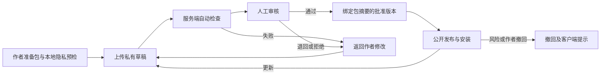

# XY Switch 统一客户端、共享插件市场与隐私保护目标

确认日期：2026-11-03。最后更新：2026-11-05（Asia/Shanghai）。

状态：完整目标范围保留，尚未全部完成。本机市场更新、回滚、撤回及共享连接重启、撤销和清理已取得隔离环境收据。2026-11-05 按用户要求先完成当前账号集成、验证并推送，再开始完整 UI 重构。原生实际推理轮换、八个真实客户端验收及公共服务上线继续待完成；最新增量见第 11 节。

## 1. 总目标

将 XY Switch 建成统一的多客户端模型与工具入口：接入桌面和命令行客户端的登录与模型配置，管理用户授权的订阅账号池，提供应用自己的插件接口与共享 MCP 运行时，建设所有用户可投稿、审核后公开分享的插件市场，并在整条数据链路保护凭据、个人信息和用户内容。

| 主线 | 必须交付的结果 |
| --- | --- |
| 1. 客户端接入 | Codex 桌面端、Codex CLI、Claude Desktop、Claude Code、OpenCode 桌面端/终端和 Gemini CLI 独立识别、登录接入、配置管理与恢复；逐版本记录实际能力 |
| 2. 订阅账号池 | 授权发现与导入、登录、刷新协调、额度状态、多账号选择与轮换、失效处理、退出和撤销；复用已有任务预算及取消机制 |
| 3. 应用插件与 MCP | XY Switch 自有插件清单、接口、权限和生命周期；统一管理多个客户端使用的 MCP 服务与隔离会话 |
| 4. 公共插件市场 | 所有注册用户均可上传和分享；自动检查后人工审核，审核通过的指定版本才公开；更新、安装验证、撤回形成完整流程 |
| 5. 脱敏与隐私 | 本地处理优先，凭据安全存储，默认减少内容留存；发送前审查、日志清理、工具和流式内容保护、上传包隐私检查 |

公共插件包通过同一目录和版本源分享。用户的订阅账号、原始会话、脱敏映射、工具会话及运行权限按用户隔离。

## 2. 目标建立前的基础

本节保留目标建立前的实现与验收基线；新增目标在暂停时的最新进展见第 9 节。

- [应用接管实现](../src-tauri/src/takeover.rs)的 `ManagedApp` 和[供应商类型](../src/types/provider.ts)目前按 Claude、Codex、Gemini 三组建模；桌面版与 CLI 的独立识别、登录和验收纳入本目标。
- [MCP 实现](../src-tauri/src/mcp.rs)已经包含 Claude、Codex、Gemini、OpenCode 四类配置读写、导入和同步；OpenCode 的登录账号与模型接管继续补齐。
- [任务预算验收](task-budget-acceptance-20261102.md)已有总尝试、费用预留、客户端重试、并发和取消基线；账号轮换必须沿用同一逻辑任务的身份和账本。
- [安装包与插件业务验收](native-plugin-acceptance-20261102.md)中的六项业务使用 Codex 宿主技能和本地运行时。XY Switch 自有插件宿主与公共市场各自建立实现和验收记录。
- 正式签名、公证、macOS x86_64/app.zip 执行以及 Linux/macOS 原生 GUI 加密同步继续按[主开发计划](development-plan.md)完成。

## 3. 客户端范围与能力验证

### 3.1 客户端矩阵

以下各行都是交付对象。登录、订阅推理、API/网关推理、MCP、配置恢复分别记录结果，避免一项测试被重复计为多项完成。

| 客户端 | 登录与账号目标 | 模型与工具目标 | 验收要求 |
| --- | --- | --- | --- |
| Codex 桌面端 | 识别安装版及实际鉴权来源，接入其官方登录方式，显示当前账号与授权状态，完成账号切换和恢复 | 验证该版本生效的 provider、模型、网关和 MCP 配置；确认 GUI 的实际请求经过预期路径 | 在真实桌面会话完成登录、请求、工具调用、断连、重启和恢复；单独记录桌面证据 |
| Codex CLI | 补齐授权账号发现、登录、刷新与账号池选择 | 延续已有接管、Responses/工具兼容和 MCP 管理 | CLI 独立执行，并验证与桌面共用配置或凭据时的锁与恢复 |
| Claude Desktop 标准登录模式 | 完成原生登录入口、授权状态识别及可用账号管理；验证该版本开放的接口和退出方式 | 接入本地 MCP/桌面扩展；对模型路由能力现场确认并记录 | 原生登录和工具执行分别验收；标准订阅模式的推理路由能力须有独立证据 |
| Claude Desktop 第三方推理模式（3P） | 接入官方支持的网关鉴权/SSO，显示模式和凭据归属 | 按 Anthropic Messages API 接入 XY 网关，保持流式、工具、模型发现和缓存字段 | 完成桌面网关推理、工具、认证过期、模型选择、预算阻断及恢复 |
| Claude Code | 接入官方登录、API/网关配置和账号池 | 延续 Anthropic 接管及 MCP 配置，保持任务和工具会话稳定 | CLI 运行、刷新、轮换、取消和配置恢复 |
| OpenCode 桌面端与终端 | 按版本接入 provider 的 API key/OAuth/授权命令，区分桌面后台服务的账号来源 | 补齐 provider/model/baseURL 接管，复用已存在的 MCP 同步 | 桌面与终端分别执行；配置路径覆盖、后台服务重启和原配置恢复 |
| Gemini CLI | 接入该版本开放的登录及 provider 鉴权，显示授权状态 | 延续既有模型与 MCP 配置支持 | 登录、真实请求、工具、取消、退出与恢复 |

平台范围按各客户端实际提供的 Windows、macOS、Linux 版本列出；报告记录 OS、架构、客户端版本和鉴权模式。客户端暂未安装、仅写入文件或只跑模拟请求的格子保持待验收。

### 3.2 共用适配器要求

1. 使用独立的客户端身份与能力描述，保留已有三组供应商配置的迁移与兼容；同一品牌的桌面版、CLI 和不同安装通道分别探测。
2. 显式选择授权来源、读取范围和写入目标。首次接入先显示预览；授权发现仅检查选定客户端的相关配置与安全存储引用。
3. 优先调用官方登录、OAuth/设备授权及配置接口。存在原生刷新进程时协调凭据所有权，防止两个进程覆盖更新后的令牌。
4. 配置写入采用备份、原子替换和冲突检测；退出接管按记录恢复。原客户端被用户修改时显示差异并保留用户选择。
5. 实际 GUI/TUI 显示当前账号、供应商、模型、配置来源和接管状态；失败说明具体缺失的接口或条件。
6. 不同模式的能力独立呈现。尚未证实的桌面订阅路由列为待调查或受平台限制，并给出依据及下一步；不将其标记为已交付。

### 3.3 已核对的官方依据

| 官方资料 | 对计划的约束 |
| --- | --- |
| [Codex provider 配置](https://learn.chatgpt.com/docs/config-file/config-advanced)及[Windows 部署](https://learn.chatgpt.com/docs/enterprise/windows-deployment) | provider 的端点和鉴权按官方配置建模；桌面与独立 CLI 的安装上下文分别确认，实际配置优先级现场验证 |
| [Codex app-server 的 ChatGPT 授权配置](https://developers.openai.com/siwc/token-sharing-open-source/codex-app-server) | 订阅推理使用为用户授权的 OAuth 接口；在实施前核对应用注册、令牌范围、刷新与具体版本兼容性 |
| [Claude Desktop 3P 安装与配置](https://claude.com/docs/third-party/claude-desktop/installation)及[网关接口](https://claude.com/docs/third-party/claude-desktop/gateway) | 3P 为标准应用启用第三方推理配置；网关须支持 Messages、流式和工具。其鉴权与标准订阅登录分别验证 |
| [Claude Desktop 本地 MCP](https://support.claude.com/en/articles/10949351-getting-started-with-local-mcp-servers-on-claude-desktop) | 本地 MCP/扩展接入有官方路径；独立验证实际工具执行和权限 |
| [OpenCode providers](https://opencode.ai/docs/providers/)、[鉴权方式](https://opencode.ai/v2/docs/cli/providers)及[桌面排障](https://opencode.ai/docs/troubleshooting/) | 支持的 provider 鉴权、baseURL 和桌面后台服务分别适配；配置和存储路径按当前版本及覆盖项探测 |

以上是 2026-11-03 的规划依据。每次实现与验收再次核对文档、安装版本及实际行为；官方说明不能替代 XY Switch 的运行证据。

## 4. 订阅账号池

### 4.1 功能与数据归属

- 账号列表包含本地别名、供应商、客户端来源、授权状态、可用模型、额度来源和最后更新时间；原始凭据由安全存储管理，数据库只保留引用和必要元数据。
- 登录发现与导入必须显式授权。界面支持新增、重新授权、启用/停用、固定账号、按策略选择、解除客户端绑定和撤销授权。
- API key、订阅 OAuth 和网关账号分开建模。额度仅采用可验证来源；没有来源时显示未知，订阅限额与美元费用分别计算。
- 定义可用、刷新中、需重新登录、额度受限、冷却、禁用等状态；同一账号的并发刷新采用锁及原子更新，失效不会陷入无限重试。
- 账号池默认属于当前用户并在本地运行；加密同步或含凭据导出由用户另行选择。市场认证使用独立身份，不获得模型账号池的凭据。
- 区分删除本地引用、退出客户端和供应商侧撤销。官方提供撤销接口时验证撤销生效；只完成本地动作时准确显示结果。

### 4.2 调度与既有预算

1. 会话默认保持账号亲和性；额度耗尽、授权失败或用户主动切换时按策略处理。对已有工具结果和不安全重放显式处理，避免重复业务动作。
2. 应用重试、供应商故障转移、账号轮换和客户端重试复用稳定任务身份；每次实际发送记入已有尝试与费用账本。
3. 轮换不会重置任务次数、预留、已知费用或未知费用。缺少计费依据的请求沿用已有未知费用策略，并显示额度/费用信息边界。
4. 取消阻止后续发送、轮换后补发和等待刷新后的重新派发；仍在飞行的请求按既有账本结算。
5. 诊断仅记录脱敏账号标识、选择原因、状态和必要计量，不暴露令牌、邮箱或原始请求。

验收：使用两套隔离测试账号或鉴权夹具验证过期、并发刷新、额度拒绝、轮换、取消与重启；再按客户端完成已授权账号的真实登录和实际推理。预留超额、未知费用和任务身份必须有针对性回归记录。

## 5. XY Switch 插件接口与共享 MCP

### 5.1 应用插件宿主

- 插件清单包含稳定 ID、作者、版本、最低宿主版本、类型、入口、兼容客户端、依赖、包摘要与权限声明；提供 SDK、样例、安装、升级、停用、卸载和回滚流程。
- 第一批支持可审查的工具/MCP 包、技能资源及模型/provider 适配器。鉴权通过宿主受控接口完成，插件仅获得被授权的操作能力。
- 默认无网络、文件、进程和凭据访问权；安装前显示权限和用途，新增权限的升级重新征求用户同意。
- 插件运行与应用进程隔离，约束目录、目标域名、资源占用和生命周期。超时、崩溃、越权或拒绝授权有可追溯结果和恢复路径。
- 兼容客户端使用各自适配格式和安装接口，保留来源版本与摘要。逐客户端验证实际加载，未支持的包类型明确显示兼容范围。

### 5.2 共享 MCP 运行时

1. XY Switch 管理服务启动、健康、停止、重启与日志；客户端经各自连接适配器使用同一份服务定义。
2. 仅在用户、包版本、配置和权限一致且服务适合复用时共享实例；有状态或不兼容的服务使用隔离实例。
3. 请求和会话按客户端、用户、任务分隔；授权、工具结果和脱敏映射不能跨会话泄漏。
4. 使用连接引用和明确所有权管理生命周期；某客户端退出不会误停其他客户端或原客户端自己启动的服务。
5. 工具执行接入任务取消与诊断；脱敏保护模型侧内容，只有授权的本地执行器按允许范围取得执行所需原值。

验收：至少 Codex 桌面端、Claude Desktop 和 OpenCode 桌面端同时调用同一个已安装工具；验证实例复用、状态隔离、权限拒绝、客户端退出、崩溃重启、应用冷启动与取消。每一种声称支持的插件类型完成安装、真实业务、升级、回滚和卸载。

## 6. 公共共享插件市场

### 6.1 服务与参与范围

- 所有注册用户具有投稿和分享权限；公开浏览与下载使用同一目录和版本源。作者、审核员和管理员按角色授权。
- 服务包括市场身份与账号管理、插件索引、私有待审存储、已审版本存储、审核工作台、发布接口及客户端安装入口。
- 作者资料默认只公开选择的展示名；邮箱、IP、登录凭据、上传草稿和审核内部信息按最小范围访问。
- 插件详情展示用途、作者、版本、兼容客户端、权限、审核状态、摘要、更新记录和举报入口。

### 6.2 投稿与审核流程

1. 自动检查包含清单、路径与解压边界、依赖、敏感信息、已知风险、权限、包大小和兼容格式。展示命中理由，使用隔离环境检查可执行组件。
2. 人工审查检查用途、代码行为、权限必要性、数据去向和实际可运行性；作者不能审核自己的提交，服务端验证权限及状态转换。
3. 审核与批准绑定精确版本和内容摘要。审核后修改包或公开描述须重新检查；每次更新重新审核，发布版本不可原地替换。
4. 私有草稿和待审对象通过直接地址也不能匿名读取；审核未通过的提交不出现在公开搜索、下载或安装接口。
5. 安装验证发布状态、版本、摘要和市场签名；权限授权成功后才运行。并发发布与审核后换包必须被服务端拒绝。
6. 举报、退回、拒绝、撤回和申诉有状态、理由及审核记录；撤回版本停止新安装，已安装用户收到明确处置和升级提示。

### 6.3 隐私与公共交付验收

- 投稿前检查整个包、描述、截图、样例和日志中的密钥、个人信息与用户内容。发现问题时返回作者修订，重新计算版本摘要并再次提交审核。
- 市场不接收用户订阅凭据、会话原文或脱敏映射。审核只接触插件所需的材料，不能查询投稿者的本地账号池。
- 默认关闭非必要跟踪；市场必要安全元数据说明用途和留存，支持用户管理投稿、资料、撤回与删除请求。
- 使用至少两个独立普通用户和独立审核身份，完整执行 A 投稿、审核、B 在另一设备安装和真实运行，再验证更新审核、越权拒绝、撤回和隐私检查。
- 最终验收在真实可访问的公共服务完成，并记录域名/地址、部署版本、服务端日志的脱敏检查和客户端版本。本地服务与开发夹具用于开发验证，公共交付仍需上述在线证据。

## 7. 脱敏与隐私保护

### 7.1 数据边界和默认行为

| 数据 | 默认处理 | 必须验证 |
| --- | --- | --- |
| 模型/API/OAuth/市场凭据 | 放入原生安全存储或受保护的加密凭据库；仅宿主授权操作可读取。鉴权头只送到对应授权端点 | 数据库、备份、诊断、插件权限和上传包不泄露；重定向不能带凭据到未经授权的目标 |
| 提示词、历史、附件与代码 | 本地扫描；模型发送使用适用的脱敏策略和预览。默认不新增明文诊断副本或云端收集 | 文本与附件命中、原文外发、误拦截、格式保持、取消和授权例外 |
| 邮箱、电话、姓名、地址、账户标识和本地路径 | 按用户规则、结构字段和已知敏感值识别，使用任务内一致占位符 | 标准样例、Unicode、编码变化、分段内容、混合数据和跨会话隔离 |
| 工具参数、结果、MCP 内容与流式回复 | 覆盖模型侧、远程工具侧和日志侧；采用边界缓冲与必要的本地原值解析 | JSON/schema、工具 ID、可执行参数、跨块敏感串和真实工具业务保持正确 |
| 诊断、异常、崩溃和遥测 | 默认只留脱敏元数据；原始内容调试需显式开启和期限，提交前预览 | 普通/错误/崩溃路径、stdout/stderr、清理策略与可导出报告 |
| 插件投稿材料 | 本地预检与服务端检查；草稿私有，修订后重新审核 | 密钥、截图、压缩包、样例、描述、待审对象地址与权限 |

### 7.2 强制约束

1. 账号导入、插件权限、远程工具和模型发送均使用具体范围的授权；授权例外记录对象、目的地、期限和用户选择。
2. 密钥和安全存储内容禁止进入模型正文、市场包或日志；必要的鉴权传递通过独立受控通道完成。
3. 脱敏映射默认保存在本地任务内存，结束或取消后释放；恢复确需持久化时使用加密、限定期限和权限，禁止进入公共市场或遥测。
4. 提供本地预览、替换规则、敏感字段策略、按目的地的例外和最小留存控制。例外不能开放日志与市场中的凭据泄露。
5. 严格隐私模式下，扫描失败、无法检查的附件、结构无法安全转换或策略未决会阻止外发并说明原因；不静默退回发送原文。
6. 流式扫描验证跨块匹配和缓冲上限；超过检查范围时按严格策略阻止后续输出或整段审查。远程工具发送也必须经过相同授权和数据边界检查。
7. 本地扫描不将待检测原文交给未经授权的第三方服务。规则检测和本地识别均说明覆盖范围与误报/漏报边界，持续用样本复核。
8. 对脱敏后破坏代码、参数、签名或工具 schema 的情况提供预览与受控处理；执行器仅在已授权本地操作范围获得原值。

验收样本使用合成秘密与个人信息。覆盖输入、输出、鉴权失败、工具异常、SSE 分块、附件、压缩包及崩溃路径，检查实际外发、磁盘和导出内容；报告既记录检测结果，也记录任务功能和延迟。真实账号验收只保留脱敏证据。

## 8. 阶段、依赖与完成标准

| 阶段 | 工作 | 依赖 | 完成证据 |
| --- | --- | --- | --- |
| 0. 隐私与能力基础 | 建立独立客户端身份/能力、账号与安全存储模型、授权边界和脱敏策略；用测试配置验证路径与实际接口 | 现有配置、代理、预算与 MCP 模块 | 类型/迁移及权限边界检查；各客户端实际版本的能力记录；敏感样本不会进入日志与外发 |
| 1. 桌面接入与账号池 | 完成矩阵中所有客户端的登录、接管/连接、恢复和账号池；优先三种指定桌面端 | 阶段 0；官方鉴权接口、所需应用注册与已授权测试账号 | 每行单独的真实客户端记录；刷新、额度、轮换、预算、取消、重启和恢复回归 |
| 2. 应用插件与 MCP | 插件 SDK、清单、隔离与权限，多个桌面客户端共享 MCP；提供代表性插件 | 阶段 0；阶段 1 的客户端连接能力 | 插件生命周期、越权拒绝及真实业务；三桌面端共享工具与会话隔离证据 |
| 3. 共享公共市场 | 投稿、服务端检查、人工审核、公开目录、签名安装、更新、撤回和资料隐私 | 阶段 2 的包规范；市场身份、服务存储、审核者和部署配置 | 多用户跨设备完整流程；待审访问/自审/换包/恶意包拒绝；真实公共访问记录 |
| 4. 联合发布验收 | 全链路隐私回归、性能、原生 GUI、签名、公证和旧配置迁移恢复 | 所有阶段及主计划中的发行项 | Windows/macOS/Linux 对应可执行版本的报告；历史能力回归；发布包和运行来源一致 |

隐私检查贯穿每阶段；账号和插件开始读取用户数据前，先完成所需的凭据与授权边界。各阶段报告列出通过、待验收和受外部接口限制的项目及依据；主目标完成需要对全部明确范围给出符合要求的证据。

## 9. 暂停检查点与恢复安排

暂停日期：2026-11-04（Asia/Shanghai）。持续目标已设为 paused；本节记录暂停时的实际进展、证据边界与接续顺序。五条主线及第 8 节全部完成标准继续保留，恢复须由用户明确提出。

### 9.1 已推进的实现

| 主线 | 暂停时进展 | 剩余验收 |
| --- | --- | --- |
| 客户端与账号池 | 已推进独立客户端、授权登录入口、账号与凭据相关实现，补充输入清理、安全错误提示和授权链接检查 | 矩阵各行的真实登录、模型请求与恢复；刷新、额度、轮换与任务预算、取消的联合验证 |
| 应用插件 | 自有插件宿主、安装与信任校验、权限和生命周期已推进实现，原生及前端专项已通过 | 总构建、页面与原生命令集成、代表性真实业务及客户端权限边界 |
| 共享 MCP | 已推进跨客户端共享管理与回滚检查；最新旧回归出现测试夹具及初始化预置数据断言问题，两处测试已修订 | 修订后的 21 项回归、真实桌面工具调用、会话隔离与恢复 |
| 公共市场 | 已实现投稿、独立审核、逐版本批准、签名安装验证、撤回和上传隐私检查；部署与现场验收材料已准备 | 主应用路由、英文词条和原生命令集成；公共 HTTPS 服务及跨用户完整流程 |
| 脱敏与隐私 | 已推进输入、错误、请求与日志保护；接管专项及新增集成前的整库基线已通过 | 当前账号池、插件、市场、工具调用和流式回复的全链路联合验证 |

### 9.2 已结束的验证与范围

| 验证 | 留存结果 | 范围与证据 |
| --- | --- | --- |
| 应用插件原生 | 45/45 通过 | [原生专项日志](../.cache/plugin-application-tests-20261104.log)；覆盖该专项，当前代码整库验收待完成 |
| 应用插件前端 | 16/16 通过 | [前端专项日志](../.cache/plugin-frontend-tests-20261104.log)；英文文案专项 TypeScript 无诊断，10 个插件 Rust 文件格式检查通过 |
| 客户端前端 | 上一段已结束的专项记录为 11/11 通过 | 覆盖登录输入清理、安全错误提示、授权链接与客户端入口；真实客户端验收待完成 |
| 接管与隐私 | 23/23 通过 | [接管专项日志](../.cache/takeover-privacy-tests-20261104.log) |
| 隐私整库基线 | 497 通过、7 忽略 | [2026-11-03 基线日志](../.cache/privacy-regression-20261103.log)；执行时间在新增插件/客户端整合之前，当前整体验收待完成 |
| 公共市场专项 | 后端 15、独立 CLI 4、前端 19、备份恢复 9 项通过 | [专项验收记录](../deploy/marketplace/verification.md)；Rust 使用独立 verification crate，前端请求与原生调用有测试替身，公共服务尚未上线 |
| 共享 MCP 旧回归 | 修订前 2 通过、19 失败；修订后待复验 | [修订前日志](../.cache/plugin-shared-mcp-regression-20261104.log)；通过结果须在恢复后重新取得 |

### 9.3 暂停时未完成项

- 共享 MCP 的[测试夹具](../src-tauri/src/shared_mcp/tests.rs)已补齐合成 home 的客户端安装目录；[管理器测试](../src-tauri/src/shared_mcp/manager_tests.rs)已改为对照初始服务器列表检查完整恢复，包含数据库预置的四个内置服务器。本次为测试夹具与断言调整，修订后的结果待确认。
- 当前原生预编译验证随用户要求主动中止，退出码 1 属于主动中止；未形成新的构建通过结果或编译失败结论。恢复后使用[已准备的 MSVC/Windows SDK 环境](../.cache/msvc-test-env.ps1)继续验证。
- 公共市场 159 个英文键已交付独立 JSON，主应用英文词条接入、页面路由、原生命令与总构建须核对。独立市场专项的通过结果只覆盖其记录的范围。
- Codex 桌面端、Claude Desktop、OpenCode 桌面端/终端，以及矩阵其余客户端的真实账号与请求验收尚未完成。标准登录模式与第三方推理模式按矩阵分别记录。
- 公共市场部署与现场验收、签名/公证、补充 macOS 执行范围及 Linux/macOS 原生 GUI 加密同步继续待完成。现有修改、专项日志和部署材料保留，新增目标尚未提交或正式发布。

### 9.4 用户恢复后的顺序

1. 完成当前原生构建与共享 MCP 21 项修订后复验，核对插件/客户端/市场的共享入口、路由、英文词条与原生命令集成。
2. 完成账号刷新、额度、轮换，以及隐私、工具、流式、任务预算和取消的联合检查；补齐当前代码的整体验收证据。
3. 按第 3 节逐行完成真实客户端验收，优先 Codex 桌面端、Claude Desktop、OpenCode；分别保留桌面与命令行证据及能力边界。
4. 对已准备的公共市场配置完成审阅并取得所需授权，再执行公共 HTTPS 部署、两用户与独立审核者的完整流程，以及目标主机备份恢复和回滚演练。
5. 完成主计划中正式签名、公证和跨平台原生验收，核对发布包与运行来源，再审查完整目标的全部完成标准。

公共市场上线所需域名、HTTPS、身份配置、数据库/对象存储、审核角色、签名密钥和部署环境，及正式发行所需签名/公证条件，见[部署文档](marketplace-deployment.md)和[市场现场验收](../deploy/marketplace/acceptance.md)。涉及费用、生产账户或外部发布时，先提供可审阅的配置、权限、数据去向和成本范围，再取得对应授权。

## 10. 2026-11-04 恢复推进记录

用户明确要求读取目标计划并继续推进，本次沿用第 9.4 节的顺序和第 8 节的全部完成标准，在原工作区继续实现与验证。

### 10.1 主应用整合与整库验证

主应用已接入客户端、账号池、本地插件与公共市场页面，并注册客户端、账号池、插件、市场传输和共享 MCP 原生命令，补齐公共市场英文词条。恢复阶段修复投稿材料的身份隐私检查，市场请求经原生传输。下列日志为恢复后执行的结果；随后原生现场阶段仅新增验收脚本、合成配置和证据，未修改产品实现。

| 验证 | 实际结果 | 证据与范围 |
| --- | --- | --- |
| 前端全测 | 624/624，53 文件通过 | [前端整库日志](../.cache/unified-privacy-fix-frontend-tests-20261104.log) |
| TypeScript 与生产构建 | 通过 | [前端构建日志](../.cache/unified-privacy-fix-renderer-build-20261104.log)；保留现有包体积警告 |
| Rust 整库 | 690 通过、0 失败、7 忽略 | [批准的 Windows 主机执行日志](../.cache/unified-privacy-fix-native-host-tests-20261104.log)；含共享 MCP、账号池和隐私回归，忽略项不计为通过 |
| 桌面和市场 debug 构建 | 通过 | [原生构建日志](../.cache/unified-privacy-fix-native-build-20261104.log)；不是签名安装包验收 |

此前沙箱执行的插件存储目录句柄限制未通过降低安全检查规避；整库结果按批准的主机环境归档。此前共享 MCP 的失败记录继续保留，不覆盖或改写成通过。

### 10.2 单一本机原生验收现场

现场标识为 `unified-native-2026-11-04T08-20-52-989Z-faebd673`。[运行元数据](../artifacts/unified-native-2026-11-04T08-20-52-989Z-faebd673/run.json)绑定隔离 home/data、debug 二进制摘要、本机 HTTP 市场和临时发布者公钥。下表均为真实 XY Switch WebView、原生命令、自有插件宿主或实际 executable stdio 桥；客户端配置与调用方为合成夹具。

| 步骤 | 已证实的结果 | 证据 |
| --- | --- | --- |
| 市场投稿、独立审核和发布 | `qa.reviewed-echo` 1.0.0 的批准版本与包摘要绑定；匿名目录仅含作者展示名 | [投稿](../artifacts/unified-native-2026-11-04T08-20-52-989Z-faebd673/market-submit.json)、[发布](../artifacts/unified-native-2026-11-04T08-20-52-989Z-faebd673/market-publish.json)、[目录](../artifacts/unified-native-2026-11-04T08-20-52-989Z-faebd673/published-catalog.json) |
| 签名安装与传输 | 未信任发布者被原生拒绝；通过 UI 明确核对临时公钥指纹后安装；renderer 到市场的直接 HTTP 请求为 0 | [安装验收](../artifacts/unified-native-2026-11-04T08-20-52-989Z-faebd673/market-install.json) |
| 三桌面 scope 的自有宿主 | 精确参数执行、缺少单次确认拒绝、防重放；未授权 CLI 无工具且调用被拒绝，秘密参数不进入执行器 | [自有宿主工具验收](../artifacts/unified-native-2026-11-04T08-20-52-989Z-faebd673/native-tools.json) |
| 共享注册与配置写入 | 初次缺少客户端配置时返回 `shared_mcp_config`；隔离 home 创建合成配置后注册成功，保留配置基线，配置仅含凭据引用 | [首次拒绝](../artifacts/unified-native-2026-11-04T08-20-52-989Z-faebd673/native-shared-registration-first-attempt.json)、[配置夹具](../artifacts/unified-native-2026-11-04T08-20-52-989Z-faebd673/client-config-fixtures.json)、[注册](../artifacts/unified-native-2026-11-04T08-20-52-989Z-faebd673/native-shared-registration.json)、[Codex/OpenCode scope 注册](../artifacts/unified-native-2026-11-04T08-20-52-989Z-faebd673/native-shared-scopes.json) |
| 实际 stdio 桥与隐私 | 初始化协商 MCP 2025-11-25；工具列表、UI 单次审核/拒绝、防重放通过；结构秘密被阻断，普通文本秘密脱敏后审阅并执行；两个会话同请求 ID 的取消互不干扰 | [共享桥工具验收](../artifacts/unified-native-2026-11-04T08-20-52-989Z-faebd673/native-shared-tools.json)；报告标明已通过步骤的首次证据来源 |
| 共配置桌面/CLI 的授权交集 | CLI 未授权时 Codex/OpenCode 共享连接工具为空、调用被拒绝；UI 显式审核完整摘要后加入两个 CLI scope；三个 owner 同请求 ID 并发产生独立审核并各自返回准确结果 | [共享 scope 工具验收](../artifacts/unified-native-2026-11-04T08-20-52-989Z-faebd673/native-shared-scope-tools.json)；Claude Code/Gemini CLI 仍未授权 |

此处记录的是五 scope 授权阶段的历史状态：`codex-desktop`、`codex-cli`、`claude-desktop`、`opencode-desktop`、`opencode-cli`。共享连接的 owner 为 Codex、Claude Desktop 和 OpenCode；共用配置的两端取插件授权交集。之后已完成签名撤回、连接撤销及冷启动清理核验，见第 11 节。

上述证据覆盖 Windows 源码 debug WebView、本机 HTTP 服务和自有原生宿主/真实 stdio 桥。合成配置文件不能证明安装或运行了 Codex、Claude Desktop、OpenCode 等第三方客户端；八行实际客户端验收、安装包、跨设备、公共 HTTPS 和其他平台的要求继续待完成，详见[能力与差距矩阵](unified-client-capability-matrix-20261104.md)。

### 10.3 接续执行

1. 上述隔离本机的市场生命周期与重启/撤销/清理步骤已完成，保留原始收据。按第 11 节先推送当前集成，再开始 UI 重构。
2. 按能力矩阵补齐真实客户端来源探测、登录/账号状态、凭据归属和配置适配缺口，分别取得桌面与 CLI 的真实请求、工具、取消、退出与恢复记录。
3. 继续账号池、预算/轮换/取消及实际外发/磁盘留存的联合验收；现有整库和本机插件证据不能替代真实订阅上游与全链路业务结果。
4. 完成可审阅的公共 HTTPS、生产身份/签名、备份恢复和跨平台发行准备，在具体授权后执行外部部署与发行。全部第 8 节完成标准仍适用，完整目标保持未完成。

## 11. 2026-11-05 增量与交付顺序

### 11.1 当前集成

- `ClientManager` 通过 `NativePoolBridge` 共享账号池，Codex managed ChatGPT 和 OpenCode V2 凭据连接提供短期、一次性的绑定候选。绑定重新核对原生身份、配置来源、用户别名和目标供应商的精确目的地；同一原生身份跨 Desktop/CLI 只保留一个有效绑定。
- 绑定只保存带盐身份/配置摘要和不透明引用；Codex managed 刷新由原生 app-server 执行，OpenCode 操作同步连接元数据。原生令牌不进入 HTTP bearer 轮换，真实原生推理调度适配器仍待实现。
- 原生操作按配置 owner 串行；同一绑定的重叠刷新合并，不同绑定不复用结果。登录期间阻断读取、绑定与刷新。重新登录或明确刷新获得新引用后才能恢复授权；普通状态读取保留既有推理 401、冷却、失败计数和额度约束。
- 运行时核验超过 300 秒、退出、配置失效或应用重启后要求重新核对原生状态。这是本机核验时效，不代表原生令牌到期时间。本地撤销不会退出第三方客户端，也不会被后续状态读取恢复。
- 前端提供独立绑定确认弹窗和账号池原生同步操作；候选过期、目的地变化和登录进行中均阻止提交，并同步刷新客户端/账号列表。
- 插件与共享 MCP 增加独立 Claude Desktop 3P scope；标准 Desktop 与 3P 共用配置时要求两者授权交集。Gemini 接管同时保存模型变量，处理重复变量并保留恢复基线。

### 11.2 本机生命周期证据

`artifacts/unified-native-2026-11-04T08-20-52-989Z-faebd673` 内以下既存收据均记录 `passed: true`，本次仅核对内容，没有重复操作市场或改写原始收据：

- `market-lifecycle-update.json`、`market-lifecycle-rollback.json`：签名更新与回滚要求重新授权，旧客户端授权不会沿用。
- `market-lifecycle-withdraw.json`：签名撤回阻止下载、缓存安装、回滚和工具执行；既发工具预览失效。
- `native-shared-restart-20261105.json`：冷启动保留撤回状态，真实 XY stdio 桥拒绝已撤回工具。
- `native-shared-revoke-20261105.json`、`native-shared-cleanup-restart-20261105.json`：三个 owner 分别撤销后删除本应用连接与凭据引用，其他配置保留；再次冷启动后不能复活。

收据属于当时 Windows 源码 debug WebView、本机市场和合成客户端配置/调用方。历史插件只有七个 scope；新增 3P scope 的合成测试不能追认为该历史现场已覆盖八个真实客户端。原始材料保留在本机，不随源码推送。

### 11.3 UI 重构要求

用户于 2026-11-05 明确要求先推送当前部分，再开始完整重构。新界面以低密度和清晰任务入口为准：减少首屏同时出现的卡片、按钮和说明，重新组织主导航，复杂配置与授权使用独立页面、弹窗或分步操作。账号/权限的确认与现有功能需要保持可达，覆盖中英文、明暗主题及窄窗口。实现和视觉验收在当前集成推送成功后开始。

### 11.4 推送前验证

- 原生整库：`cargo test --manifest-path src-tauri/Cargo.toml --lib -- --test-threads=1`，719 通过、0 失败、7 忽略，执行 175.14 秒。覆盖 19 项原生池桥测试以及账号/隐私/插件/共享 MCP 的现有回归。
- 前端整套：53 个测试文件、645 项全部通过；应用类型检查、`tsc -b` 与 `vite build` 通过。补齐原生绑定状态的英文目录项。
- 验证日志保留在本机忽略目录 `.cache/unified-integration-*-20261105.log`。发布范围为源码、文档和部署模板；本机测试收据、隔离配置、构建产物及签名材料不在提交范围内。
- 本次是当前集成里程碑。原生推理调度、其余客户端驱动、真实八客户端联合验收及公共市场部署仍需继续；验证详情与范围见能力矩阵第 6 节。
